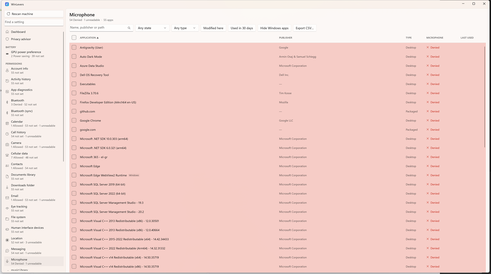
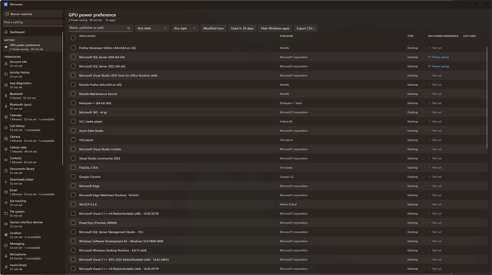
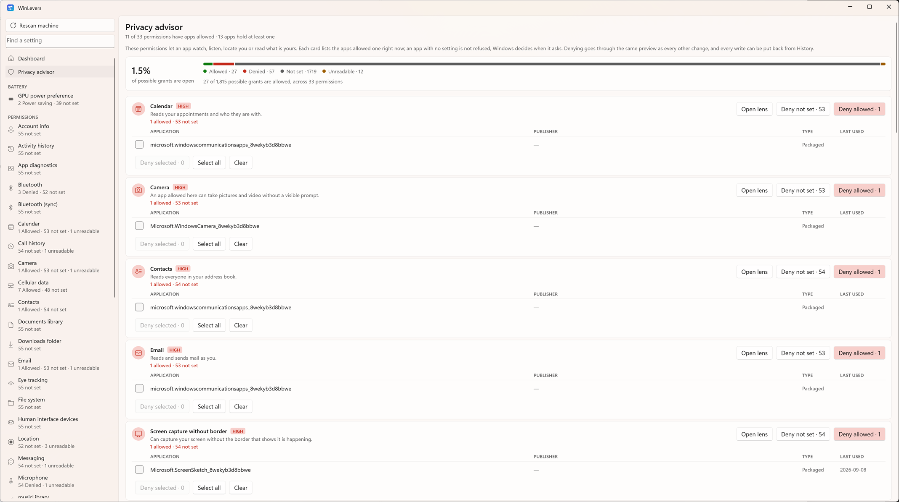
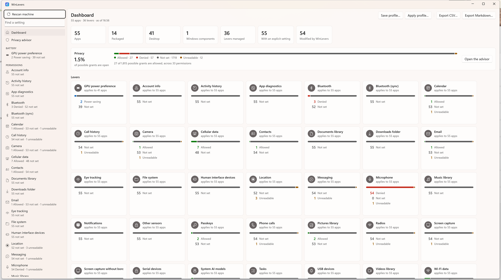
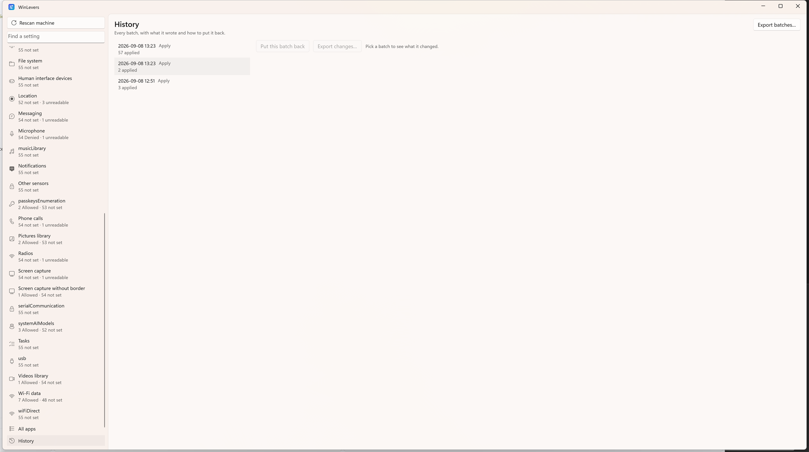
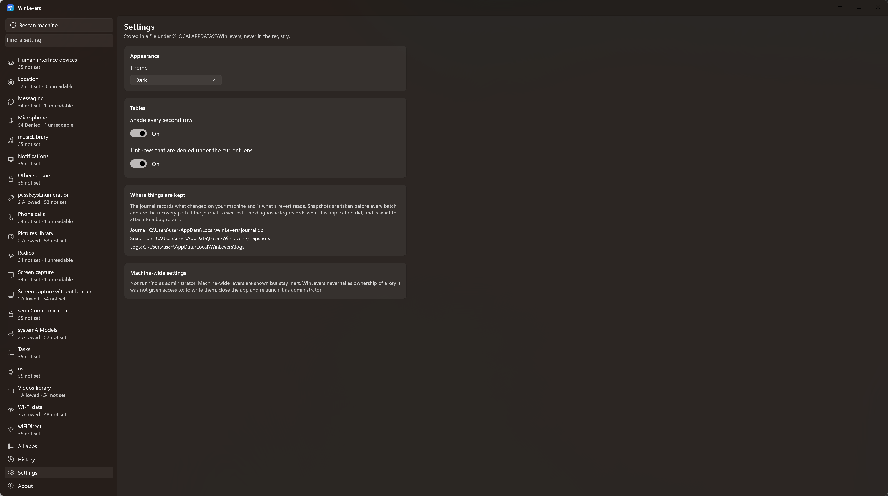

<p align="center">
  
</p>

<h1 align="center">WinLevers</h1>

<p align="center">
  <strong>Change the privacy permissions and GPU preference of many Windows apps at once,<br />
  see every registry write before it happens, and put any of them back.</strong><br />
  For Windows 10 and 11. Open source. No accounts, no cloud, no tracking.
</p>

<p align="center">
  
  
  
  <a href="LICENSE"></a>
</p>

<p align="center">
  <a href="https://github.com/dimitriostzr/winlevers/releases/latest"><strong>⬇&nbsp;Download the latest release</strong></a><br />
  Windows 10 and 11 (x64 and Arm) · installer or portable<br />
  <sub>Free, no account. <a href="#first-run-the-windows-warnings">First-run notes</a> · <a href="#build-it-yourself">Build it yourself</a></sub>
</p>



---

- [Download](#download)
- [Why](#why)
- [Features](#features)
- [How it works](#how-it-works)
- [Safety](#safety)
- [Privacy](#privacy)
- [Limits](#limits)
- [Build it yourself](#build-it-yourself)
- [Repository layout](#repository-layout)
- [Support](#support) · [Trademarks](#trademarks) · [Licence](#licence)

## Download

Ready-to-run builds are on the [Releases](https://github.com/dimitriostzr/winlevers/releases/latest) page. Pick the file for your system; each link below always fetches the latest version:

| System                      | File | Notes |
| --------------------------- | ---- | ----- |
| Windows 10 / 11             | [`WinLevers-win-x64-setup.exe`](https://github.com/dimitriostzr/winlevers/releases/latest/download/WinLevers-win-x64-setup.exe) | Installs for you only, into `%LOCALAPPDATA%\Programs\WinLevers`, with no administrator prompt. |
| Windows 11 on Arm           | [`WinLevers-win-arm64-setup.exe`](https://github.com/dimitriostzr/winlevers/releases/latest/download/WinLevers-win-arm64-setup.exe) | The same. |
| Windows, without installing | [`WinLevers-win-x64-portable.zip`](https://github.com/dimitriostzr/winlevers/releases/latest/download/WinLevers-win-x64-portable.zip) or [`…-arm64-portable.zip`](https://github.com/dimitriostzr/winlevers/releases/latest/download/WinLevers-win-arm64-portable.zip) | Unzip anywhere and run `WinLevers.App.exe`. No Start menu entry or uninstaller. |

Windows 10 version 1809 or later, 64-bit. Nothing else needs to be installed: the .NET runtime
and the Windows App SDK are included. Uninstalling keeps the journal of what the app changed.

`SHA256SUMS.txt` lists each file's checksum. To check a download, run
`Get-FileHash .\WinLevers-win-x64-setup.exe` in PowerShell and compare the hash with the line in
`SHA256SUMS.txt`.

### First run: the Windows warnings

The builds aren't signed with a paid code-signing certificate, so Edge and Windows warn about
them until enough people have downloaded them. Both warnings come from SmartScreen, the
reputation check built into Windows: they mean the file is unsigned and not yet widely
downloaded, not that anything was found in it. You see each one once.

**1. Edge: "… isn't commonly downloaded"**

1. In the downloads panel, point at the file and choose **⋯ (More actions) → Keep**.
2. Edge asks again: choose **Show more → Keep anyway**.

Chrome and Firefox may ask the same in their own words; choose **Keep**.

**2. Windows: "Windows protected your PC"**

1. Run the installer. On the blue window, choose **More info**.
2. Check that the app name is the file you downloaded and the publisher reads
   **Unknown publisher**, then choose **Run anyway**.

**The portable zip:** unblock it before unzipping, and Windows won't ask again for the files
inside.

1. Right-click the zip and choose **Properties**.
2. On the **General** tab, tick **Unblock** and choose **OK**.
3. Unzip it and run `WinLevers.App.exe`.

**If Microsoft Defender names a threat** instead (for example "Trojan:Win32/…"), don't override
it. Check the file against `SHA256SUMS.txt` as above: unsigned installers are sometimes flagged
by mistake, but if you are unsure, delete the file and [build it yourself](#build-it-yourself)
from the source.
> [!WARNING]
> **Use at your own risk.** WinLevers edits the Windows registry. It is provided as is, without
> warranty of any kind, and the author accepts no liability for any loss arising from its use.
> Take a System Restore point before your first batch: the launch notice has a button for it.

## Why

Windows keeps a per-app choice for each of about three dozen capabilities: camera, microphone,
location, contacts, calendar, screen capture, documents and more. Each has its own page under
_Settings → Privacy & security → App permissions_, with one toggle per app. The GPU preference
lives somewhere else entirely, under _System → Display → Graphics_, where you add apps by hand.

On a machine with a couple of hundred apps, "deny the microphone to everything except three apps"
is an afternoon of clicking, and Windows keeps no record of what you changed and offers no undo.

WinLevers puts every one of those settings, for every app it can find, in one grid. Select as many
apps as you like, choose a value, and apply it to all of them in one batch, after seeing exactly
what will change. Every write is journaled with the value it replaced, so any of it can be put
back.

Two words come up throughout:

- A **lever** is one setting WinLevers manages, such as microphone access or GPU preference.
- A **lens** is the grid filtered to one lever, so you see every app's state for it at a glance:
  allowed, denied or not set.

## Features

### The app grid and lenses

Every desktop app from the uninstall records, and every packaged app Windows has recorded a
permission for, in one sortable grid. Pick a lens in the sidebar to see one lever across all of
them, with live counts, then select any set of apps and change several levers in one batch.



### Privacy advisor

The permissions that matter most (camera, microphone, location and the like), which apps hold
each one, and a one-click deny for the allowed apps or for those with no setting. A bar shows
the machine's overall privacy posture.



### Dashboard

An overview of the machine across every lever: how many apps are allowed, denied and not set,
from the latest scan.



### History and rollback

Every batch you have applied, every write in it with the old and new value, and a revert for
the whole batch or a single change. A value changed by something else since is reported and left
alone.



### And also

- **Profiles:** capture the machine's explicit settings and apply them again later.
- **Exports:** CSV and Markdown of everything the grid shows.
- **Settings:** light and dark themes, table options, and the window remembers where it was.



## How it works

```
 scan                      plan                        apply                     history
 ────                      ────                        ─────                     ───────
 read every lever  ──────▶ preview every write  ──────▶ snapshot, write,  ──────▶ revert a batch
 for every app             old value → new value        read back, journal        or one change
```

1. **Scan.** WinLevers reads the consent store and the GPU preference keys under
   `HKEY_CURRENT_USER`, the same values the Windows Settings app edits, for every app it finds.
2. **Plan.** Your selection becomes a list of registry writes, each with its old and new value.
   Nothing is written until you have seen that list and confirmed it.
3. **Apply.** The values about to change are saved as a JSON snapshot and flushed to disk. Each
   write is then made, read back, and recorded in a SQLite journal with the value it replaced. A
   write that fails its read-back is journaled as failed.
4. **Revert.** From _History_, put back a whole batch or one change. If a value was changed
   outside WinLevers since, the revert says so and leaves it alone.

Two kinds of setting are managed:

- **Privacy permissions:** one lever per capability Windows tracks, each _Allowed_, _Denied_ or
  _Not set_. _Not set_ is a real third state, meaning Windows has no recorded choice; WinLevers
  never collapses it into _Denied_.
- **GPU power preference:** for desktop apps, power saving, high performance, or let Windows
  decide.

The design and the reasoning behind it are in [docs/design.md](docs/design.md) and
[docs/architecture.md](docs/architecture.md).

## Safety

What WinLevers never does:

- Never writes without a preview you have confirmed.
- Never touches machine-wide settings (`HKLM`), and never asks for administrator rights.
- Never takes ownership of a registry key or changes its permissions.
- Never overwrites a value whose format it doesn't recognise.
- Never reverts a value that was changed outside it after it wrote it.
- Never stores its own settings in the registry it manages.

Registry access sits behind an interface, and over 450 tests run the pipelines and rollback
against an in-memory registry, so all of it is checked without touching a real one.

## Privacy

- **No network access.** No telemetry, analytics, crash reporting or update checks.
- **Nothing leaves your computer.** All state is kept in `%LOCALAPPDATA%\WinLevers`:
  - `journal.db`: every batch and write, for rollback.
  - `snapshots/`: the JSON snapshot taken before each batch.
  - `logs/`: diagnostic logs; check the newest if something goes wrong.
  - `settings.json`: theme, window position and table options.

Details are in [SECURITY.md](SECURITY.md).

## Limits

- **Per-user only.** Everything it changes is under `HKEY_CURRENT_USER`. Machine-wide policy set
  by an administrator or by Group Policy still wins.
- **Not every app.** The grid lists desktop apps from the uninstall records, and packaged apps
  once Windows has recorded a permission for them.
- **Snapshots can't be restored from the app yet.** They are there to inspect, or to recover from
  by hand; the journal is what puts changes back.
- **Two kinds of lever.** The background-activity and startup levers in the design were not
  built.

## Build it yourself

Install the [.NET 10 SDK](https://dotnet.microsoft.com/download) and Visual Studio 2026 (or
compatible) with the **.NET Desktop Development** workload and the **Windows App SDK** component.
The C++ workload is not needed. Then:

1. Clone the repository and open **`WinLevers.sln`**.
2. Right-click **WinLevers.App** and choose **Set as Startup Project**.
3. Set the platform to **x64** (or **ARM64** on Arm).
4. Press **F5**.

To make the same files the Releases page offers (a portable zip and an
[Inno Setup](https://jrsoftware.org/isinfo.php) installer for x64 and ARM64, in
`artifacts/release`):

```powershell
./scripts/Build-Release.ps1                  # needs Inno Setup 6
./scripts/Build-Release.ps1 -SkipInstaller   # the portable zips only
```

The version is `<Version>` in `Directory.Build.props`.

The engine and view models build and test on macOS and Linux too, without the WinUI shell:

```sh
dotnet test WinLevers.Engine.slnx
```

A command-line tool shares the same engine. It is not in the downloads: run it from source. It
uses the same journal as the app, so a batch applied in one can be reverted from the other.

```sh
cd src/WinLevers.Cli
dotnet run -- scan [--all]                                     # read every managed setting; writes nothing
dotnet run -- levers                                           # every lever and its allowed values
dotnet run -- plan  --set <leverId>=<value> --app <substring>  # show what would change; writes nothing
dotnet run -- apply --set <leverId>=<value> --app <substring>  # make the changes, after confirming
dotnet run -- history                                          # past batches
dotnet run -- revert <batchId>                                 # put a batch back
dotnet run -- probe [--key <path>] [--hklm] [--depth n]        # dump raw keys for levers not yet built
```

`--app` matches part of an app's name or key and can be repeated; `--all-apps` targets every app
and has to be asked for by name. `apply` and `revert` ask before writing; `--yes` skips the
question, for scripts, but the full list of writes is always printed first, and every write is
journaled.
**Troubleshooting**

- **Visual Studio shows "unknown project configuration mappings":** close it and delete the
  hidden `.vs/` folder next to the solution.
- **Build fails mentioning `VC\Tools\MSVC`:** `WinLevers.App.csproj` works around this when the
  C++ workload is missing; installing **Desktop development with C++** also fixes it.
- **F5 starts the CLI instead of the app:** set **WinLevers.App** as the startup project again;
  Visual Studio stores that choice per user.

## Repository layout

```
src/WinLevers.Core           The lever engine: scan, plan, apply, revert. No platform code.
src/WinLevers.Data           The SQLite journal and the JSON snapshots.
src/WinLevers.Presentation   Every view model, testable without a GUI.
src/WinLevers.Windows        The real registry and app discovery.
src/WinLevers.App            The WinUI 3 shell.
src/WinLevers.Cli            The command-line tool.
tests/                       xUnit tests, against an in-memory registry.
installer/                   The Inno Setup script.
scripts/                     The release build.
docs/                        Design and architecture.
```

## Support

WinLevers is a personal tool, complete for what it was built to do, and provided as is. There is
no support channel, and issues and pull requests are not accepted. It is free to fork: see
[CONTRIBUTING.md](CONTRIBUTING.md) for conventions, a reading order, and how to keep registry
changes safe in your fork.

## Trademarks

Microsoft, Windows, Visual Studio, WinUI and .NET are trademarks of Microsoft Corporation. Every
other name shown in the app, including the app names read from this machine's own records,
belongs to its owner and is used only to identify the software. WinLevers is an independent
project, not affiliated with, sponsored by, endorsed by or supported by Microsoft or any company
whose apps appear in it.

## Licence

[MIT](LICENSE) © 2026 Dimitrios T. The downloads also carry the .NET runtime, the Windows App SDK
and other components, which keep their own licences; see `THIRD_PARTY_NOTICES.txt` beside the app.